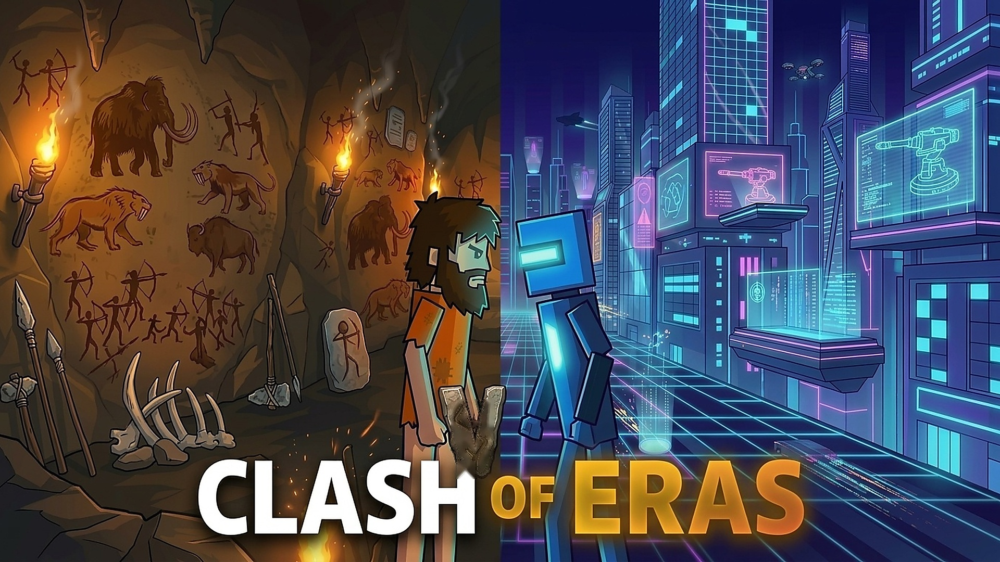
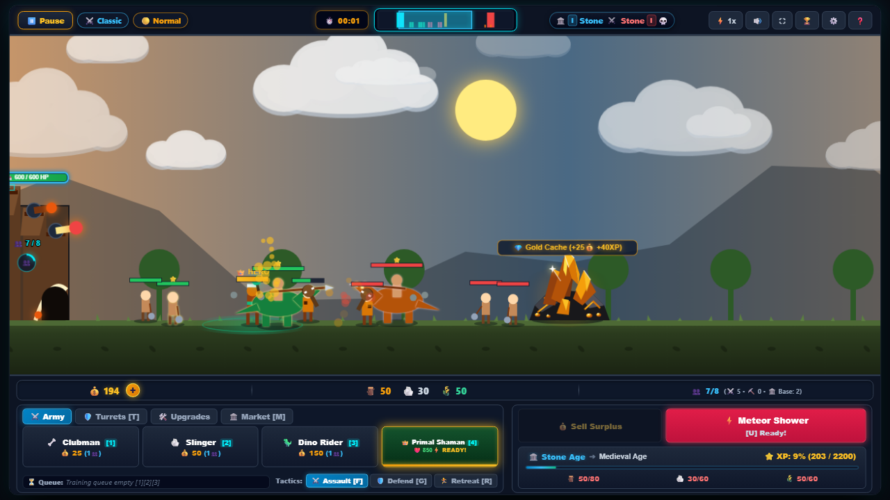
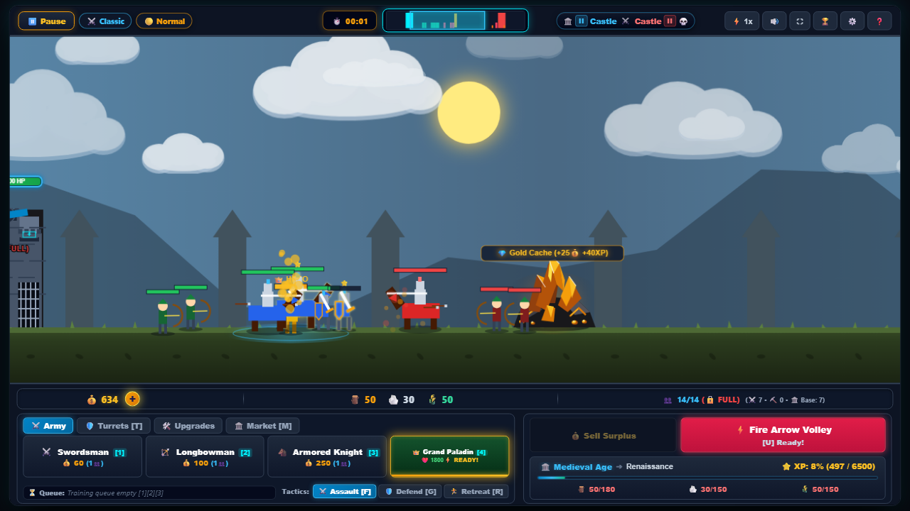
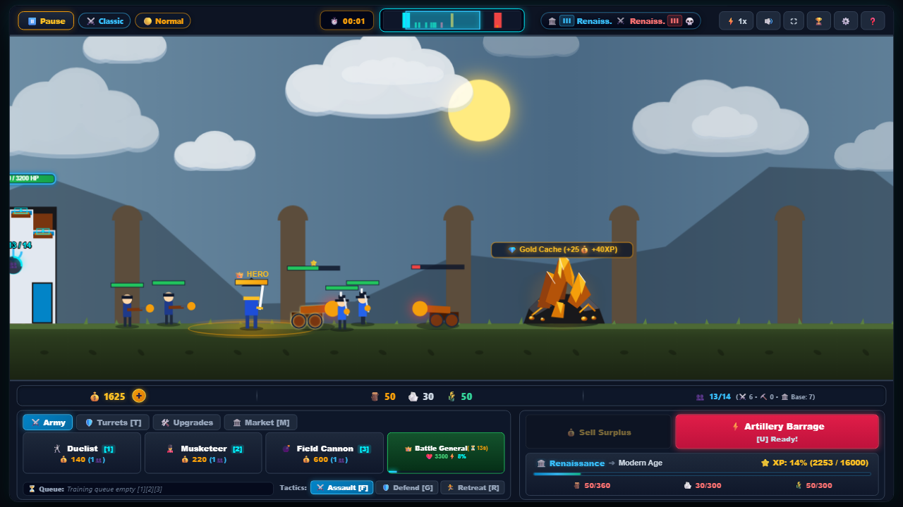
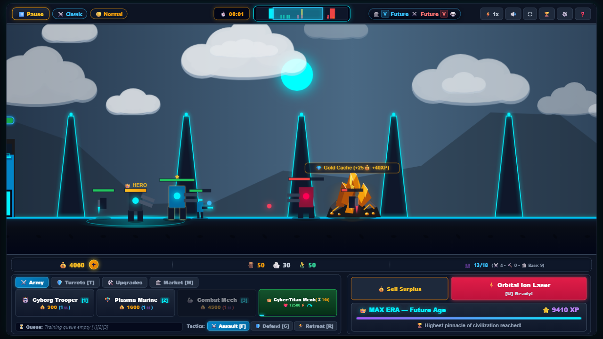
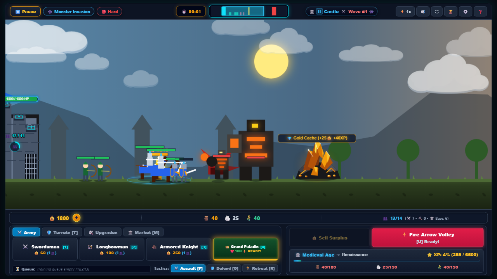
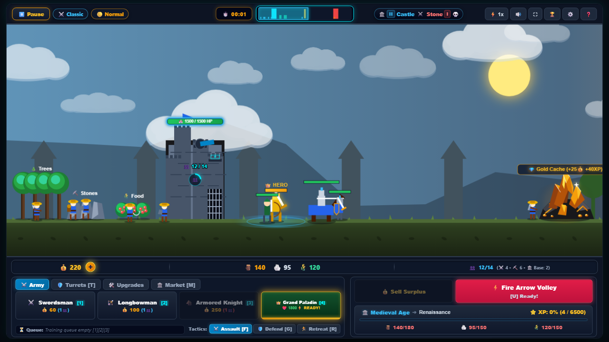

# Clash of Eras — Commercial Real-Time Strategy (RTS) Engine & Multiplayer State Sync

[](https://developer.mozilla.org/)
[](README.md)
[](https://www.python.org/)
[](README.md)
[](README.md)
[](README.md)
[](README.md)



> **Commercial Domain:** Cross-Platform Real-Time Strategy Title, Deterministic Multi-Era Game Simulation & Multi-Platform SDK Packaging  
> **Target Platforms:** Poki, CrazyGames, GameDistribution, YouTube Playables, Itch.io  
> **Game Architecture:** Custom 60 FPS 2D Canvas Renderer, Deterministic State Evaluator, Entity-Component Pool  
> **Multiplayer Stack:** Python Real-Time Room Coordinator, Socket Handshake Protocol, State Reconciliation  
> **Asset Optimization:** Minified Binary Assets, Texture Atlasing, Sub-3-Second Cold Load Times  

---

## 🎯 What is Clash of Eras? (Core Purpose & Mission)

**Clash of Eras** is an evolutionary, real-time strategy (RTS) game engineered for high-performance web and cross-platform distribution. 

Players advance through five distinct civilizational epochs—from prehistoric tribal skirmishes to hyper-advanced futuristic cyber-warfare—balancing resource extraction, fortress defensive arrays, epoch research, and tactical troop deployment against adaptive AI or live human opponents:

```text
[ Stone Age ] ➔ [ Medieval Siege ] ➔ [ Renaissance Gunpowder ] ➔ [ Modern Warfare ] ➔ [ Cybernetic Future ]
```

The title demonstrates full-lifecycle commercial game engineering: custom canvas rendering without bloated third-party engines, sub-millisecond memory pooling, strict multi-platform SDK compliance (CrazyGames, Poki, GameDistribution), and deterministic socket-based multiplayer.

---

## 🎮 Gameplay & Epoch Progression Showcase

| Epoch 1: Stone Age Skirmish | Epoch 2: Medieval Castle Siege |
|:---:|:---:|
|  |  |
| *Clubmen, slingers, dinosaur cavalry & primitive stone fortresses.* | *Knights, crossbowmen, catapults & fortified stone bastions.* |

| Epoch 3: Renaissance Gunpowder | Epoch 4: Futuristic Cyber-Warfare |
|:---:|:---:|
|  |  |
| *Musketeers, field cannons, duelists & early industrial ballistics.* | *Plasma infantry, hover tanks, beam turrets & cybernetic titans.* |

| Titan Boss Encounter Mode | Real-Time Resource & Base Economy |
|:---:|:---:|
|  |  |
| *Colossal multi-phase boss battles with targeted weak-point mechanics.* | *Real-time gatherer routing, tech tree research & turret fortifications.* |

---

## ⚙️ Core Architectural & Engineering Highlights

### 1. 🚀 Custom 60 FPS HTML5 Canvas Rendering Pipeline (`rts_renderer.js`, `rts_sprites.js`)
- **Zero Third-Party Engine Overhead:** Built from scratch on native HTML5 2D Canvas context (`CanvasRenderingContext2D`) without heavy frameworks (Phaser/PixiJS), achieving an instantaneous 1.7 MB total bundle size.
- **Layered Render Pass Architecture:** Background parallax scenery ➔ Base structures ➔ Ground units (Y-sorted depth ordering) ➔ Dynamic projectiles ➔ Particle physics (blood splatters, smoke, muzzle flashes) ➔ Heads-Up Display (HUD).
- **Procedural Sprite Compositing:** Unit animations, weapon swings, recoil states, and projectile trajectories are calculated dynamically with trigonometric vector math.

### 2. 🌐 Real-Time Multiplayer Networking Protocol (`server.py`)
- **Asynchronous Room Coordinator:** Python TCP socket server manages active lobby rooms (`WAITING` ➔ `READY` ➔ `PLAYING`) and orchestrates client pairings.
- **Deterministic Command Serialization:** Instead of transmitting continuous unit positions across the wire, clients exchange deterministic, timestamped player action ticks (spawn unit, trigger base special, research epoch), drastically reducing bandwidth consumption to under 5 KB/s.
- **Client-Side Prediction & Interpolation:** Ensures smooth unit animations and immediate tactile feedback while eliminating rubberbanding during network latency spikes.

### 3. 🧠 Hierarchical Heuristic AI Engine (`rts_ai.js`)
- **Dynamic Threat Evaluation:** Evaluates opponent unit composition in real time and counter-picks unit types (e.g., cavalry counters archers, heavy armor counters infantry).
- **Macro/Micro Economy Balancing:** Heuristic state machine dynamically shifts economic budget between gatherer generation, base defense turret construction, and epoch evolution thresholds based on current lane pressure.

### 4. ⚡ Zero-GC Object Pooling & Memory Management
- **Pre-Allocated Entity Pools:** Units, projectiles, floating combat text, and particle emitters are recycled from fixed-size object pools, eliminating runtime garbage collection pauses during chaotic 100+ unit lane battles.
- **Sub-3-Second Cold Boot:** Texture atlases and audio sprites ensure instantaneous loading even on low-tier mobile devices and constrained mobile browsers.

### 5. 📱 Commercial Platform Compliance & Multi-SDK Architecture
- **Unified Ad & SDK Layer (`rts_ads.js`):** Modular abstraction layer interfacing with **CrazyGames SDK v2**, **GameDistribution API**, and **Poki SDK**.
- **Responsive Resolution Scaling:** Normalized virtual coordinate viewport (1920x1080 canonical resolution) with automatic aspect-ratio scaling (letterboxing/pillarboxing) and touch/mouse input normalization.

---

## 📁 Repository Structure

```text
Clash-of-Eras/
├── src/
│   ├── rts_game.js            # Main 60 FPS game loop, state transitions & input manager
│   ├── rts_renderer.js        # Hardware-accelerated 2D canvas drawing & particle pipeline
│   ├── rts_entities.js        # Unit class hierarchy, fortress bases & projectile physics
│   ├── rts_sprites.js         # Procedural sprite sheet animator & vector compositor
│   ├── rts_ai.js              # Heuristic AI opponent decision tree & economy manager
│   ├── rts_data.js            # 5-Epoch tech tree, unit attributes, upgrades & balance tables
│   ├── rts_audio.js           # Multi-channel WebAudio sound FX & dynamic BGM mixer
│   └── rts_ads.js             # CrazyGames, Poki & GameDistribution SDK integration gateway
│
├── server/
│   ├── server.py              # Real-time Python socket multiplayer lobby & state sync server
│   └── requirements.txt       # Python networking dependencies
│
└── assets/                    # High-resolution production banner & epoch gameplay screenshots
```

---

## 🛠️ Technology Stack Breakdown

| Layer | Technologies | Architectural Purpose |
|---|---|---|
| **Client Core** | JavaScript (ES6+), HTML5 Canvas 2D | High-speed game loop, unit physics, spatial collisions |
| **Multiplayer Server** | Python 3.10+, Sockets, Threading | Lobby matchmaking, room state coordination, event dispatch |
| **Audio Engine** | Web Audio API | Low-latency polyphonic sound effects, spatial combat audio |
| **Commercial SDKs** | CrazyGames SDK v2, Poki SDK, GameDistribution | Rewarded ads, gameplay telemetry, platform lifecycle events |
| **Asset Pipeline** | Texture Atlasing, WebP, OGG/MP3 | Sub-3-second cold load, memory footprint optimization |

---

## 🔒 Commercial & Intellectual Property Notice
*Clash of Eras is a commercial strategy game property. Production distribution bundles and platform-specific release keys are protected under commercial publishing agreements with web game portals.*
